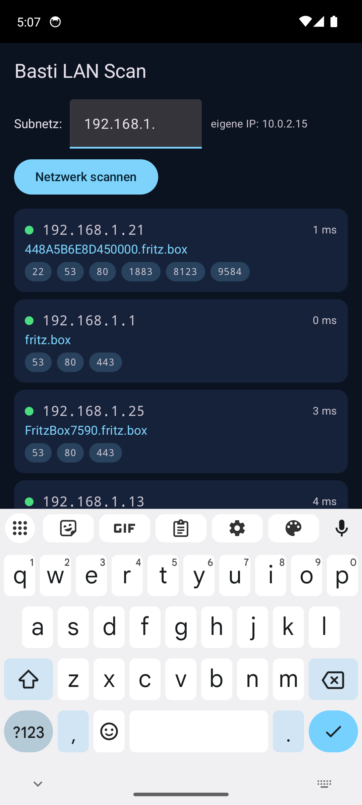
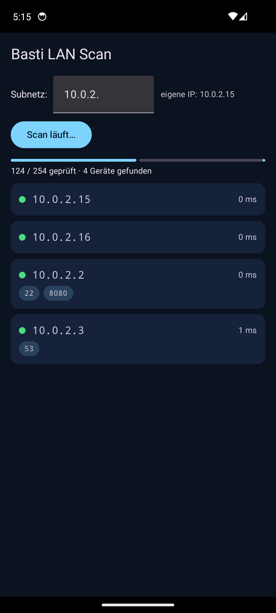

# Basti LAN Scan

Ein offener LAN-Scanner für Android — funktioniert wie Fing, aber ohne Werbung, Tracking und Cloud-Zwang. Alles bleibt auf deinem Gerät und in deinem Netzwerk.



## Features

- **Netzwerk-Scan** über das komplette /24-Subnetz (254 IPs, ~40 parallele Prober, Scan in < 1 Minute)
- **ICMP-Ping** mit RTT-Anzeige (ms)
- **ARP-Tabelle** → MAC-Adressen der Geräte
- **TCP-Port-Scan** auf bekannte Dienste: 22 SSH · 53 DNS · 80 HTTP · 443 HTTPS · 1883 MQTT · 5000 · 8080 · 8123 Home Assistant · 9584 ha-mcp
- **Klickbare Ports** öffnen den Browser direkt auf dem Gerät — `http://ip:port` (HTTPS bei 443)
- **Hostnamen via Reverse-DNS** (z. B. `fritz.box`, `Waschmaschine.fritz.box`)
- **Editierbares Subnetz-Feld** (Standard: dein eigenes WLAN-Subnetz)
- **Device-Karten**: anklickbar für Details (MAC, alle Ports, Ping)
- Dark-UI mit Jetpack Compose (Material 3)



## Datenschutz

| Was | Wohin |
|---|---|
| Scan-Ergebnisse | Nur im Gerät — werden nie hochgeladen |
| Berechtigungen | Nur `INTERNET` (kein Standort, kein Storage) |
| Werbung / Analytics |Keines |
| Server-Kontakt | Keiner — nur dein eigenes LAN |

## Installation

Die fertige, signierte APK liegt in den [GitHub-Releases](../../releases) — herunterladen, antippen, installieren (Android 7+).

## Selbst bauen

```bash
gradle.bat assembleDebug          # Debug-APK
gradle.bat assembleRelease        # Release-APK (mit keystore.properties, siehe app/build.gradle)
```

Benötigt JDK 17 und den Android SDK (compileSdk 34). `local.properties` zeigt auf den SDK-Pfad.

## Bekannte Grenzen

- Kein mDNS und kein Hersteller-Lookup per MAC-OUI (geplant)
- Kein Traceroute / Speedtest (bewusst minimal gehalten)

## Lizenz

MIT
